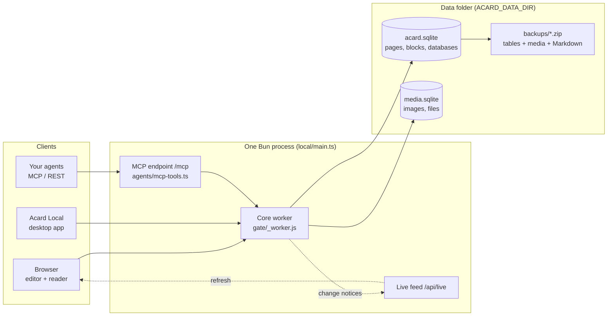

<p align="center"><b>English</b> · <a href="README.ko.md">한국어</a> · <a href="README.zh-CN.md">简体中文</a></p>

<p align="center">
  
</p>

<p align="center">
  <b>Acard is the open Notion you can run locally.</b><br>
  Pages, blocks and databases in a fast editor, served by one small server on your own machine or network.
</p>

<p align="center">
  <a href="docs/install-server.md">Install the server</a> ·
  <a href="docs/install-client.md">Connect a device</a> ·
  <a href="https://github.com/Hakubisual/open-notion-acard/releases/latest">Download the desktop app</a> ·
  <a href="docs/why-acard.md">Why Acard</a> ·
  <a href="docs/architecture.md">Architecture</a>
</p>

<p align="center">
  <a href="https://github.com/Hakubisual/open-notion-acard/actions/workflows/ci.yml"></a>
  <a href="LICENSE"></a>
  <a href="https://github.com/Hakubisual/open-notion-acard/releases/latest"></a>
</p>

---

## What it is

Acard is a Notion-style workspace that you host yourself. One Bun process serves the editor, stores everything in
SQLite files inside one data folder, and answers browsers, the Acard Local desktop app and your own AI agents.
Nothing leaves your machine unless you turn on a cloud feature.

It works for one person on a laptop, and for a team that keeps a server on an office LAN, a home lab or a VPN.

## Why Acard

| | Acard | Notion | Obsidian |
| --- | --- | --- | --- |
| Where your data lives | SQLite files in a folder you choose | Notion's cloud | Markdown files in a local vault |
| Run your own server for a team | Yes: one process, AGPL-3.0 licensed | No | Not built in (shared vaults use Obsidian Sync) |
| Block editor with databases | Yes: 7 database views, relations, rollups, formulas | Yes | Markdown notes; Bases adds database views |
| AI agents read and write pages | MCP and REST built into your own server | Notion's API and hosted MCP, in Notion's cloud | Community plugins |
| Source code | Open (AGPL-3.0) | Closed | Closed app, open plugin API |

Notion and Obsidian are both excellent tools. Acard is for people who want Notion's block-and-database editing
without handing their documents to a hosted service. The full comparison, with the code each claim rests on, is in
[docs/why-acard.md](docs/why-acard.md).

## Screenshots

| Desktop | Mobile |
| --- | --- |
|  |  |

<p align="center"></p>

## How it works



More detail, including the block and database model and how sync and backups work: [docs/architecture.md](docs/architecture.md).

## Features

- **Block editor**: headings 1-4 (each can fold), lists, to-dos, toggles, quotes, callouts, code, tables, equations, images and embeds. `/` commands and Markdown shortcuts.
- **Columns**: place blocks side by side in 2-4 columns, drag between them and resize.
- **Block colors**, callout icons, and **buttons** that add a database row.
- **Page look**: emoji or uploaded icon, cover, and page width.
- **Databases**: table, board, gallery, list, calendar, timeline and chart views; filters, sorting, sub-items, two-way relations, person and ID properties, row templates (also on a schedule) and formulas.
- **Parts**: charts, tables, heatmaps, badges and flow diagrams drawn from JSON.
- **Page tree**: nested pages, folders, drag and drop, favorites, templates, quick notes.
- **Sharing**: publish a page or share it by link as a clean read-only view.
- **Markdown in and out**: import and export Markdown and Notion exports.
- **Full-text search** across every page.
- **Agents**: a local MCP endpoint and a REST API let your own scripts and AI agents read and write pages.
- **Backups**: one zip with every table, every file and a readable Markdown copy of each page; daily automatic backups.
- **Fast**: no front-end framework; the build fails if the editor or reader grows past its size budget.
- **Three languages**: English, Korean and Simplified Chinese interface.

## Install

There are two ways to run Acard. Pick the one that fits; you can move your data between them later with a
backup file.

### For yourself (one computer)

Download `Acard-Local-Setup-0.3.3.exe` from the
[latest release](https://github.com/Hakubisual/open-notion-acard/releases/latest), run it, and choose
**Use on this computer** on the first screen. That is all: the app starts its own small server in the background,
keeps your notes in `%APPDATA%\Acard Local\data`, and needs no account and no password. Nothing leaves your computer.

> **Windows SmartScreen:** the installer is not code-signed yet, so Windows may say *"Windows protected your PC"*.
> Click **More info → Run anyway**, or build the app yourself.

On macOS and Linux, build the app from source: `bun install && cd desktop && bun install && bun run dist`.

Prefer no app at all? Run the server directly and use your browser:

```sh
git clone https://github.com/Hakubisual/open-notion-acard.git
cd open-notion-acard
bun install && bun run build
ACARD_DATA_DIR=./data ACARD_APP_DIR=./dist ACARD_LANG=en bun local/main.ts
# open http://127.0.0.1:47811/
```

Step by step, with backups, updates and uninstalling: [docs/install-user.md](docs/install-user.md).

### For a team (one server)

One person sets up a server on the office LAN, a home lab or a VPN, with a password:
[docs/install-server.md](docs/install-server.md) covers Windows and Linux step by step (service, firewall, backups,
updates, HTTPS). Everyone else opens the server address in a browser, or installs Acard Local and chooses
**Connect to a team server**: [docs/install-client.md](docs/install-client.md).

## Connect your AI agent

Acard has an MCP endpoint and a REST API built in, so Codex, Claude Code or any MCP client can read and write your
pages.

### On your own computer

When Acard runs on your computer (the desktop app with **Use on this computer**, or `bun local/main.ts`), agents on the
same computer connect without a token or an account, and nothing leaves the PC:

```sh
codex mcp add acard --url http://127.0.0.1:47811/mcp
claude mcp add --transport http acard http://127.0.0.1:47811/mcp
```

Any other MCP client:

```json
{ "mcpServers": { "acard": { "url": "http://127.0.0.1:47811/mcp" } } }
```

- REST API: `http://127.0.0.1:47811/api/v1`, described at `http://127.0.0.1:47811/api/v1/openapi.json`.
- Agent guide: `http://127.0.0.1:47811/AGENTS.md` and `http://127.0.0.1:47811/llms.txt`.
- CLI (pull pages to Markdown files and push them back):
  `npx -y --package=http://127.0.0.1:47811/acard-cli.tgz acard pull ./notes`. Commands: `pull`, `push`, `mcp`,
  `whoami`; the default server is the local one.

If the app chose another port because 47811 was busy, use that port instead. Set `ACARD_LOCAL_API=0` to turn the
token-free local access off.

### On a team server

A team server never lets agents in with a person's password. Set `ACARD_AGENT_TOKEN` (24 characters or more) on the
server, and give agents that token as a bearer token:

```sh
export ACARD_AGENT_TOKEN=...   # the same value as on the server
codex mcp add acard --url http://<server>:47811/mcp --bearer-token-env-var ACARD_AGENT_TOKEN
```

Other clients send the header `Authorization: Bearer <token>`. The CLI reads `ACARD_URL` and `ACARD_TOKEN`. Without
`ACARD_AGENT_TOKEN`, agents cannot reach `/mcp` or `/api/v1` on a password-protected server. Details:
[docs/install-server.md](docs/install-server.md#connect-agents).

## Not included

This repository is the self-hosted core. Features that depend on the hosted service are not part of it: AI writing
and polishing, the chat agent and its work journal, email and Google accounts, the admin console and billing. Small
neutral stubs (`gate/hosted-*.ts`, `features/ai-service.js`, `local/edition.ts`) take their place so the core
builds and runs on its own. The writing guide and its triggers, AI writing and auto-organize are hosted-only too.
Your own agents still connect to your own server (see above). If you would rather not run a server, use the
[hosted version](https://acard.dev).

## Project layout

| Path | What |
| --- | --- |
| `assets/`, `editor-next/` | Web app: editor, reader, databases, UI kit |
| `gate/`, `features/`, `agents/` | Server core (shared with the hosted version) and the MCP tools |
| `local/` | Self-hosted server: Bun + SQLite, LAN mode, password sign-in, backups, sync client |
| `desktop/` | Acard Local, the Electron desktop client |
| `packages/acard-cli/` | CLI: sync pages to local Markdown files, bridge MCP over stdio |
| `migrations/`, `workers/`, `wrangler.toml` | Optional Cloudflare / Postgres deployment |
| `tests/` | `bun test` |

## Contributing

Bug reports, ideas and pull requests are welcome. Start with [CONTRIBUTING.md](CONTRIBUTING.md); report security
issues privately as described in [SECURITY.md](SECURITY.md). Changes per release: [CHANGELOG.md](CHANGELOG.md).

## Renamed from OpenNotion

This project was called OpenNotion up to v0.1.0. Your data and settings carry over: the server keeps the same
`ACARD_*` settings and data folder, `git pull` follows GitHub's redirect to the new address, and Acard Local picks
up the server saved in the old desktop app on its first start.

## License

[AGPL-3.0](LICENSE). Third-party notices: [THIRD_PARTY_NOTICES.md](THIRD_PARTY_NOTICES.md).

Acard is an independent open-source project. It is not affiliated with, endorsed by, or sponsored by Notion Labs, Inc.
or the makers of Obsidian. "Notion" and "Obsidian" are trademarks of their owners and are used here only to describe
and compare.
