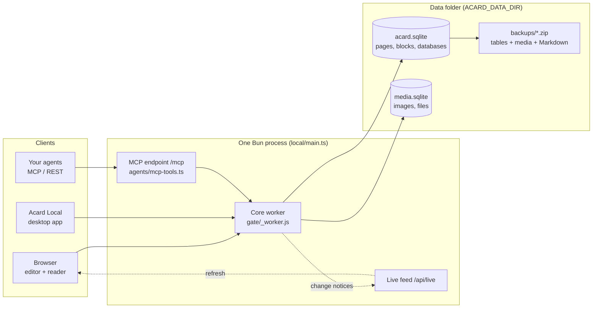

<p align="center"><a href="README.md">English</a> · <a href="README.ko.md">한국어</a> · <b>简体中文</b></p>

<p align="center">
  
</p>

<p align="center">
  <b>Acard 是一个可以在本地运行的开源 Notion。</b><br>
  用快速的编辑器管理页面、块和数据库，一台放在你自己电脑或内网里的小服务器就能承载全部内容。
</p>

<p align="center">
  <a href="docs/install-server.md">安装服务器</a> ·
  <a href="docs/install-client.md">连接设备</a> ·
  <a href="https://github.com/Hakubisual/open-notion-acard/releases/latest">下载桌面应用</a> ·
  <a href="docs/why-acard.zh-CN.md">为什么选 Acard</a> ·
  <a href="docs/architecture.md">架构（英文）</a>
</p>

---

## 这是什么

Acard 是一个自托管的 Notion 风格工作区。一个 Bun 进程提供编辑器，把所有内容存进同一个数据文件夹里的 SQLite 文件，
并响应浏览器、Acard Local 桌面应用和你自己的 AI 智能体。除非你主动开启云端功能，数据不会离开你的设备。

既可以一个人在笔记本上用，也可以把服务器放在办公室局域网、家庭实验室或 VPN 里，供团队共同使用。

## 为什么选 Acard

| | Acard | Notion | Obsidian |
| --- | --- | --- | --- |
| 数据存放位置 | 你选定文件夹里的 SQLite 文件 | Notion 云端 | 本地仓库（vault）里的 Markdown 文件 |
| 为团队自建服务器 | 可以：一个进程，AGPL-3.0 许可 | 不可以 | 没有内置（共享仓库需使用 Obsidian Sync） |
| 块编辑与数据库 | 支持：7 种视图、关联、汇总、公式 | 支持 | Markdown 笔记，Bases 提供数据库视图 |
| AI 智能体读写页面 | 你的服务器内置 MCP 与 REST | Notion API 与托管 MCP（在 Notion 云端） | 社区插件 |
| 源代码 | 开源（AGPL-3.0） | 闭源 | 应用闭源，插件 API 开放 |

Notion 和 Obsidian 都是优秀的工具。Acard 适合想要 Notion 式块与数据库编辑、又不想把文档交给托管服务的人。
每一项都附有代码依据的完整对比见 [docs/why-acard.zh-CN.md](docs/why-acard.zh-CN.md)。

## 截图

| 桌面端 | 移动端 |
| --- | --- |
|  |  |

<p align="center"></p>

## 工作原理



块与数据库模型、同步与备份的详细说明见 [docs/architecture.md](docs/architecture.md)（英文）。

## 功能

- **块编辑器**：标题 1-4（均可折叠）、列表、待办、折叠块、引用、标注、代码、表格、公式、图片和嵌入。支持 `/` 命令和 Markdown 快捷输入。
- **分栏**：把块并排放进 2-4 栏，可拖动、可调宽度。
- **块颜色**、标注图标，以及能新增数据库行的**按钮**。
- **页面外观**：表情或上传的图标、封面、页面宽度。
- **数据库**：表格、看板、画廊、列表、日历、时间线和图表视图；筛选、排序、子项、双向关联、人员与 ID 属性、行模板（可定时重复）和公式。
- **部件**：用 JSON 数据绘制的图表、表格、热力图、徽章和流程图。
- **页面树**：嵌套页面、文件夹、拖放、收藏、模板、快速笔记。
- **分享**：发布页面或通过链接分享，对方看到简洁的只读页面。
- **Markdown 导入导出**：导入和导出 Markdown 以及 Notion 导出文件。
- **全文搜索**：搜索所有页面的正文。
- **智能体**：本地 MCP 端点和 REST API，让你的脚本和 AI 智能体读写页面。
- **备份**：一个 zip 包含所有表、所有文件和每个页面的 Markdown 副本；每天自动备份。
- **快速**：不依赖前端框架；编辑器或阅读器超出体积预算时构建会失败。
- **三种语言**：英文、韩文和简体中文界面。

## 安装

Acard 有两种安装方式，按需选择即可。以后想换，用备份文件把数据搬过去就行。

### 个人安装（一台电脑）

从[最新发布](https://github.com/Hakubisual/open-notion-acard/releases/latest)下载 `Acard-Local-Setup-0.3.3.exe`，
运行后在首屏选择 **在这台电脑上使用**。这样就完成了：应用会在后台启动自己的小服务器，笔记保存在
`%APPDATA%\Acard Local\data`，不需要账号，也不需要密码，数据不会离开这台电脑。

> **Windows SmartScreen：** 安装程序暂未进行代码签名，Windows 可能提示 *"Windows 已保护你的电脑"*。
> 点击 **更多信息 → 仍要运行**，或者自行构建应用。

macOS 和 Linux 请从源码构建：`bun install && cd desktop && bun install && bun run dist`。

不想装应用、只用浏览器？直接运行服务器：

```sh
git clone https://github.com/Hakubisual/open-notion-acard.git
cd open-notion-acard
bun install && bun run build
ACARD_DATA_DIR=./data ACARD_APP_DIR=./dist ACARD_LANG=zh bun local/main.ts
# 打开 http://127.0.0.1:47811/
```

包括备份、更新和卸载在内的分步说明：[docs/install-user.md](docs/install-user.md)（英文）。

### 团队服务器安装

由一个人在办公室局域网、家庭实验室或 VPN 中架设一台带密码的服务器。Windows 和 Linux 上的服务注册、防火墙、备份、
更新和 HTTPS 见[服务器安装指南](docs/install-server.md)（英文）。其他人用浏览器打开服务器地址，或者安装 Acard Local
并选择 **连接到团队服务器**（[客户端指南](docs/install-client.md)，英文）。

## 连接 AI 智能体

Acard 内置 MCP 端点和 REST API，Codex、Claude Code 或任何 MCP 客户端都能读写你的页面。

### 在自己的电脑上

Acard 在你的电脑上运行时（桌面应用选择了 **在这台电脑上使用**，或者运行了 `bun local/main.ts`），同一台电脑上的
智能体无需令牌、无需账号即可连接，数据不会离开这台电脑：

```sh
codex mcp add acard --url http://127.0.0.1:47811/mcp
claude mcp add --transport http acard http://127.0.0.1:47811/mcp
```

其他 MCP 客户端在配置 JSON 中写入：

```json
{ "mcpServers": { "acard": { "url": "http://127.0.0.1:47811/mcp" } } }
```

- REST API：`http://127.0.0.1:47811/api/v1`，接口说明在 `http://127.0.0.1:47811/api/v1/openapi.json`。
- 智能体说明：`http://127.0.0.1:47811/AGENTS.md` 和 `http://127.0.0.1:47811/llms.txt`。
- CLI（把页面拉取为 Markdown 文件，再推送回去）：
  `npx -y --package=http://127.0.0.1:47811/acard-cli.tgz acard pull ./notes`。命令有 `pull`、`push`、`mcp`、
  `whoami`，默认连接本机服务器。

如果 47811 端口被占用、应用换了别的端口，请改用那个端口。设置 `ACARD_LOCAL_API=0` 可关闭免令牌的本机访问。

### 在团队服务器上

团队服务器不会让智能体使用人的登录密码。请在服务器上设置 `ACARD_AGENT_TOKEN`（至少 24 个字符），再把这个值作为
bearer 令牌交给智能体：

```sh
export ACARD_AGENT_TOKEN=...   # 与服务器上的值相同
codex mcp add acard --url http://<服务器>:47811/mcp --bearer-token-env-var ACARD_AGENT_TOKEN
```

其他客户端发送请求头 `Authorization: Bearer <令牌>`；CLI 读取 `ACARD_URL` 和 `ACARD_TOKEN`。没有设置
`ACARD_AGENT_TOKEN` 时，智能体无法访问设有密码的服务器上的 `/mcp` 和 `/api/v1`。
详见[服务器安装指南](docs/install-server.md#connect-agents)（英文）。

## 不包含的内容

本仓库是自托管核心。依赖托管服务的功能不在其中：AI 写作与润色、聊天智能体及其工作日志、邮箱与 Google 账号、
管理控制台和计费。这些位置由小型中性桩代码（`gate/hosted-*.ts`、`features/ai-service.js`、`local/edition.ts`）
代替，核心可以独立构建和运行。写作指南及其触发器、AI 写作和自动整理同样只在托管版中提供；你自己的智能体照常连接你自己的服务器（见上文）。
如果不想自己运行服务器，可以使用[托管版 Acard](https://acard.dev)。

## 参与贡献

欢迎提交问题、想法和拉取请求。请先阅读 [CONTRIBUTING.md](CONTRIBUTING.md)；安全问题请按 [SECURITY.md](SECURITY.md)
私下报告。各版本的变更见 [CHANGELOG.md](CHANGELOG.md)。

## 由 OpenNotion 更名而来

本项目在 v0.1.0 之前名为 OpenNotion。你的数据和设置会完整延续：服务器沿用相同的 `ACARD_*` 设置和数据文件夹，
`git pull` 会跟随 GitHub 的重定向到新地址，Acard Local 首次启动时会读取旧桌面应用中保存的服务器地址。

## 许可证

[AGPL-3.0](LICENSE)。第三方声明：[THIRD_PARTY_NOTICES.md](THIRD_PARTY_NOTICES.md)。

Acard 是独立的开源项目，与 Notion Labs, Inc. 及 Obsidian 的开发者没有任何隶属、背书或赞助关系。
"Notion" 和 "Obsidian" 是其各自所有者的商标，此处仅用于说明和比较。
